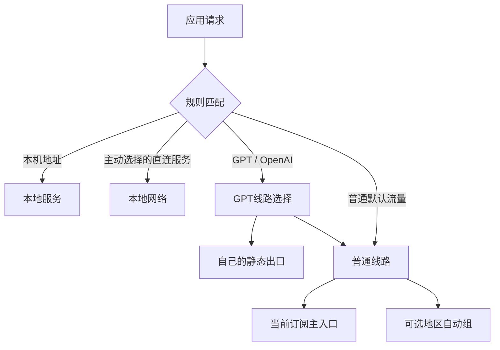

# Clash 分流设计引导

把「哪些服务走固定出口、哪些跟随当前订阅、哪些直连」设计成可解释、可验证、能回退的方案。面向 Clash Verge Rev + Mihomo；其他客户端可参考原理，但应重新核对扩展机制。

本项目仅含重新编写的通用代码和虚构示例。没有真实订阅、节点凭据、个人账号、设备路径、聊天记录或截图。

## 从哪里开始

| 你现在的目标 | 入口 |
| --- | --- |
| 不会配置，先理解并做设计 | [逐步引导手册](docs/261015-guide.md) |
| 已有方案，准备验证和回退 | [验证与排错](docs/261015-validation.md) |
| 准备公开自己的版本 | [隐私与发布](docs/261015-privacy.md) |
| 想理解前置代理再接静态出口 | [链式出口与边界](docs/261015-chaining.md) |
| 让 AI 协助完成 | [AI 协作约定](AGENTS.md)，然后发送下面的提示词 |

```text
请阅读 README、引导手册和 AGENTS.md，带我设计分流。
先询问业务目标与当前结构，不索取密码、订阅链接、令牌或完整认证文件。
先做设计和隔离验证；没有我的应用指令，不修改运行中的代理或系统设置。
```

## 目标结构



选择组只是配置中的分支，不是额外的远端服务器。上图的静态与订阅是可选路径；只有明确配置 `dialer-proxy` 才涉及额外代理跳转。

## 六个阶段

1. 写下目标：服务、访问出口、DNS 出口、失败时的行为。
2. 备份：保存全局扩展、订阅选择、系统和浏览器相关设置。
3. 生成候选：在本地填自己的设计，凭据独立保管。
4. 隔离验证：检查规则、引用、循环、订阅切换兼容性和内核语法。
5. 小范围应用：保持规则模式，一次只改一层，再检查真实连接。
6. DNS 与系统接管：在访问分流正常后，独立验证 DNS、IPv6、WebRTC。

每一阶段都有停点。可以只做前四步，不改变现有网络。

## 本地工具（可选）

需要 Node.js 22 或更高版本，无第三方依赖，无需 `npm install`。

```sh
npm run guide
npm run build
npm run check
```

问答只保存业务偏好到 `local/design.json`，生成 `local/global-script.js`。生成器不读取你的 Clash 数据目录，不连接代理，不自动安装或应用。

- 第一次默认保留订阅主入口，静态出口和 DNS 改写都关闭。
- 准备自己的静态节点后，再打开设计中的 `staticExit.enabled`。
- 直连服务也由自己选择；不同地区、单位网络可能有不同可达性。
- 原订阅的应用专用规则继续保留；地区自动组只控制「普通默认流量」，不是所有原生策略组。
- 模板要求原配置只有一个最终 `MATCH`；遇到已有总开关、多个 `MATCH` 或其他全局扩展，先人工合并。

## 无真实数据的演练

```sh
npm run demo
npm test
```

演练使用文档保留地址和 `.invalid` 占位节点，无法用于上网。`local/demo/demo-*.json` 可交给自己已有的 Mihomo 做 `-t` 配置检查；检查方法见验证文档。演练目录与自己的节点文件分开。

## 准备上传 GitHub

```sh
npm run check
npm run release
```

只上传 `dist/clash-routing-guide-public/` 的内容。发布目录按 `PUBLIC_FILES.json` 导出，排除 `local/`、备份、日志和所有私有生成文件；`.gitignore` 本身不能阻止网页拖拽误上传。

本项目不自动创建 Git 仓库，不提交、不推送，也没有遥测或自动上传逻辑。自动扫描只能发现部分风险，公开前仍要人工审阅。

## 能证明什么

自动测试验证通用配置变换；Mihomo `-t` 验证配置可以解析。二者都不能证明节点可用、出口固定、长连接不中断或 DNS 无泄漏。必须在自己的环境完成实际验证。

2026-10-15 本地验证：Node.js 24.12.0 下 12 项测试通过；Mihomo 1.19.32 下默认、静态、DNS、地区自动四种虚构示例的 `-t` 检查通过。未使用真实节点测试，也未验证其他系统的客户端界面与进程匹配。

日期：2026-10-15；维护：项目维护者。参考来源与适用边界见各手册。
